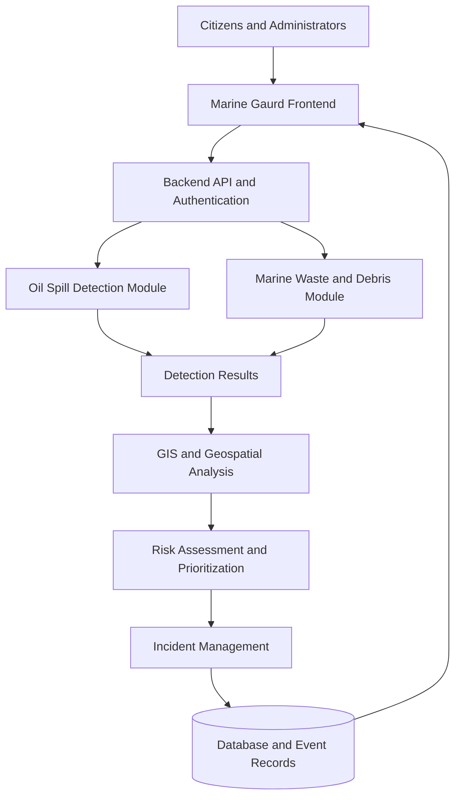

🌊 Marine Gaurd — Intelligent Marine Pollution Response System


### AI-Powered Marine Pollution Detection, Geospatial Intelligence & Response Management

**An integrated platform for detecting, assessing, monitoring, and managing marine pollution incidents.**

Marine Gaurd is an intelligent marine environmental monitoring and pollution-response platform that brings **AI-powered oil-spill detection, marine waste and debris detection, geospatial intelligence, pollution-risk assessment, and incident management** into one centralized system.

The platform is designed to help citizens report pollution, support administrators in reviewing incidents, visualize geographic information, assess potential environmental risks, and organize investigation and response workflows.

---

## 📑 Table of Contents

- [Overview](#-overview)
- [Problem Statement](#-problem-statement)
- [Objectives](#-objectives)
- [Core Modules](#-core-modules)
- [Key Features](#-key-features)
- [System Architecture](#-system-architecture)
- [Technology Stack](#-technology-stack)
- [How It Works](#-how-it-works)
- [Security and Access Control](#-security-and-access-control)
- [Project Structure](#-project-structure)
- [Installation and Setup](#-installation-and-setup)
- [Testing and Validation](#-testing-and-validation)
- [Deployment](#-deployment)
- [Current Limitations](#-current-limitations)
- [Future Enhancements](#-future-enhancements)
- [Responsible Use](#-responsible-use)
- [Contributing](#-contributing)
- [License](#-license)

---

## 🌍 Overview

Marine pollution threatens marine ecosystems, coastal communities, biodiversity, fisheries, and ocean health. Identifying pollution incidents and organizing the information required for investigation can be challenging when reporting, detection, mapping, and incident management are handled separately.

**Marine Gaurd addresses this challenge through a centralized digital platform** that brings marine pollution information and response workflows together.

The platform integrates two major pollution-management modules:

1. **Oil Spill Detection and Assessment**
2. **Marine Waste and Debris Detection and Assessment**

These modules are supported by geospatial visualization, incident reporting, risk assessment, administrative review, and audit-oriented workflows.

### Project Vision

To support cleaner oceans through intelligent pollution monitoring, accessible incident reporting, geographic analysis, and organized environmental response.

## 🚨 Problem Statement

Marine pollution incidents can be difficult to identify, locate, assess, and manage efficiently.

Key challenges include:

- Detecting potential oil spills and marine debris from available imagery or reports.
- Identifying the geographic locations and potential impacts of pollution.
- Managing reports and incident records in a centralized system.
- Prioritizing incidents according to available risk information.
- Supporting transparent investigation and administrative review.
- Connecting detection outputs with practical incident-management workflows.

Marine Gaurd aims to address these challenges with an integrated, modular, and extensible platform.

## 🎯 Objectives

- Support the identification of potential oil spills and marine waste.
- Provide a centralized workflow for pollution reporting and incident tracking.
- Display supported geographic information through interactive maps.
- Generate risk indicators to assist incident prioritization.
- Enable authorized administrators to review and manage incidents.
- Maintain event histories for traceability and investigation.
- Establish a foundation for future satellite, vessel-tracking, and environmental-data integrations.

---

## 🧩 Core Modules

### 1. 🛢️ AI Oil Spill Detection and Assessment

<text> </text>

This module supports oil-spill analysis using the available image-processing and machine-learning components.

**Capabilities include:**

- Analysis of supported images for potential oil-spill patterns.
- Machine-learning-based detection or segmentation, where configured.
- Generation of detection results and confidence information, where supported.
- Geographic representation of incident locations and spill boundaries, when available.
- Incident recording and investigation workflows.
- Risk assessment and prioritization support.

**Objective:** Help users identify potential oil-spill incidents and organize relevant information for further investigation.

### 2. ♻️ Marine Waste and Debris Detection

This module focuses on marine waste, floating debris, and related pollution reports.

**Capabilities include:**

- Marine waste incident reporting and record management.
- Waste-detection workflows using the available model or detection components.
- Geographic and coastal-area assessment using supported GIS functionality.
- Incident classification and review.
- Pollution-risk assessment and prioritization support.
- Administrative investigation and status management.

**Objective:** Improve the organization and geographic assessment of marine waste incidents to support environmental monitoring and cleanup planning.

### 3. 🗺️ Geospatial Intelligence

The geospatial component brings incident information into a geographic context.

Depending on the configured data and available integrations, it can support:

- Interactive incident maps.
- Geographic coordinates and incident locations.
- GeoJSON-based spatial data.
- Spill boundaries and detection overlays where generated.
- Coastal-area analysis and geographic impact assessment.
- Visualization of available vessel positions or trajectories.

### 4. ⚠️ Pollution Risk Assessment and Prioritization

Marine Gaurd includes risk-assessment workflows intended to help organize incidents for review.

Potential assessment factors include:

- Detection confidence.
- Estimated pollution extent.
- Geographic location.
- Proximity to sensitive coastal or environmental areas.
- Incident severity and available supporting information.

Risk results are decision-support indicators. They do not independently establish the actual environmental impact or determine legal responsibility.

### 5. 📋 Incident and Report Management

This component connects pollution information with operational workflows.

Supported project workflows may include:

- Citizen pollution reports.
- Image uploads and report records.
- Incident review and status updates.
- Administrative verification and investigation.
- Incident-event histories and audit-oriented records.
- Linking detection outputs to relevant incident records.

### 6. 🔐 Administration and Access Control

The administrative layer supports controlled access to platform functions.

Depending on the configured permissions, this can include:

- User authentication.
- Role-based access control (RBAC).
- Protected backend endpoints.
- Administrative incident review.
- Report approval and verification workflows.
- Recording relevant administrative events.

---

## ✨ Key Features

| Feature | Purpose |
|---|---|
| AI-assisted detection | Analyze supported imagery for potential marine pollution |
| Oil-spill module | Support spill detection and incident assessment |
| Marine-waste module | Organize waste detection and reporting workflows |
| Geospatial mapping | Display pollution incidents and available spatial information |
| Risk assessment | Help prioritize incidents for human review |
| Citizen reporting | Collect pollution reports and supporting images |
| Incident management | Track reports, investigations, and status changes |
| Role-based access | Restrict protected operations according to assigned permissions |
| Event history | Support traceability of recorded incident activity |
| API-based architecture | Separate frontend presentation from backend services |
| Containerization | Provide a foundation for reproducible deployment |

*Feature availability depends on the implemented code, configuration, model files, and connected services.*

---

## 🏗️ System Architecture

Marine Gaurd follows a modular architecture that separates the user interface, backend APIs, machine-learning components, database, and geospatial processing.



### Architecture Components

- **Frontend:** Provides the interface for reporting, visualization, and incident management.
- **Backend API:** Handles application requests, validation, business logic, and access control.
- **AI/ML components:** Support the configured image-analysis and detection workflows.
- **GIS processing:** Manages supported geographic data and spatial analysis.
- **Database:** Stores application records and related incident information.
- **Deployment configuration:** Defines the intended application packaging and hosting setup.

---

## 🛠️ Technology Stack

The project uses the following technologies across its application components. The exact dependencies should be confirmed against the current repository configuration.

| Layer | Technologies |
|---|---|
| Frontend | React, TypeScript, Vite |
| UI and styling | Tailwind CSS, Lucide icons |
| Maps | Leaflet and related mapping integrations |
| Backend | Python, FastAPI |
| API validation | Pydantic |
| Database access | SQLAlchemy |
| Machine learning | PyTorch and computer-vision components |
| Geospatial processing | GeoJSON, Shapely, GeoPandas, PostGIS where configured |
| Database | SQLite for supported local or fallback workflows; PostgreSQL for configured deployments |
| Deployment | Docker, Docker Compose, Nginx, Render configuration |

---

## 🔄 How It Works

### Step 1 — Report or provide pollution data

A user submits a pollution report or supplies supported imagery through an available workflow.

### Step 2 — Analyze the incident

The relevant module processes the input using the detection and validation components available in the application.

### Step 3 — Generate detection information

The system records available results, which may include a predicted class, confidence information, or geographic representation.

### Step 4 — Assess geographic context

Available coordinates and spatial data are used to place the incident in its geographic context.

### Step 5 — Assess and prioritize risk

The risk-assessment workflow uses configured factors to support incident prioritization.

### Step 6 — Review and manage the incident

Authorized personnel can review incident details, update status, and record relevant investigation events through the implemented workflows.

### Step 7 — Monitor incident records

The platform provides access to stored records and available map or dashboard views to support ongoing review.

---

## 🔒 Security and Access Control

Marine Gaurd includes security-oriented application components intended to protect sensitive operations.

Security areas include:

- Authentication and role-based access control.
- Protected API routes.
- Input validation and schema-based request handling.
- Controlled administrative workflows.
- Incident-event and audit-oriented records.
- Environment-based configuration for deployment.
- Separation of application configuration from source code where configured.

**Security note:** These features do not automatically establish production security. Actual protection depends on the deployed configuration, secret management, database permissions, rate limiting, HTTPS, logging, and operational monitoring.

---

## 📁 Project Structure

The following is a conceptual overview of the main application areas. Refer to the repository for the exact directory structure and file names.

```text
Marine-Gaurd/
├── backend/
│   ├── app/
│   │   ├── api/
│   │   ├── core/
│   │   ├── gis/
│   │   ├── ml/
│   │   ├── models/
│   │   ├── schemas/
│   │   └── ...
│   ├── tests/
│   ├── Dockerfile
│   └── ...
├── frontend/
│   ├── src/
│   ├── public/
│   ├── Dockerfile
│   ├── nginx.conf
│   └── ...
├── docs/
├── docker-compose.prod.yml
├── render.yaml
├── .dockerignore
└── README.md
```

### Main directories

- `backend/app/api/` — API routes and application endpoints.
- `backend/app/core/` — Core settings and shared application configuration.
- `backend/app/gis/` — Geographic and spatial processing components.
- `backend/app/ml/` — Machine-learning and detection components.
- `backend/app/models/` — Application data models.
- `backend/app/schemas/` — Request and response schemas.
- `backend/tests/` — Automated tests.
- `frontend/` — User interface and frontend deployment configuration.
- `docs/` — Project documentation and deployment guidance.

---

## 💻 Installation and Setup

The commands below are a general setup guide. Confirm the actual dependency files, environment variable names, and application entry points in the repository before running them.

### Prerequisites

- Git
- Python version supported by the backend dependencies
- Node.js version supported by the frontend dependencies
- npm
- A configured database, if required by the selected workflow
- Docker and Docker Compose, if using containerized deployment

### 1. Clone the repository

```bash
git clone https://github.com/Prajith3027/Marine-Gaurd.git
cd Marine-Gaurd
```

### 2. Set up the backend

```bash
cd backend
python -m venv .venv
```

Activate the environment on Windows:

```powershell
.venv\Scripts\Activate.ps1
```

On Linux or macOS:

```bash
source .venv/bin/activate
```

Install the dependencies using the repository's actual dependency file. For example, if it contains `requirements.txt`:

```bash
pip install -r requirements.txt
```

Configure the required environment variables using the project's configuration instructions. Do not commit real passwords, API keys, or secret values.

Start the backend using the verified application entry point. For example, if the application exposes `app.main:app`:

```bash
uvicorn app.main:app --reload
```

If the entry point differs, use the module path specified in the repository.

### 3. Set up the frontend

Open another terminal:

```bash
cd frontend
npm install
npm run dev
```

Use the local address printed by Vite to access the frontend.

### 4. Configure the database

Choose the database configuration supported by the project:

- **Local development:** Use the configured SQLite workflow if supported.
- **PostgreSQL deployment:** Configure the database URL, credentials, schema initialization, and any required spatial extensions.

Do not assume that switching database URLs alone migrates existing data. Follow the project's schema and migration instructions.

### 5. Run with Docker

The repository includes deployment-related Docker configuration. From the project root, inspect the available Compose services and required environment variables before running the production configuration.

```bash
docker compose -f docker-compose.prod.yml config
```

After verifying the configuration and providing the required environment variables:

```bash
docker compose -f docker-compose.prod.yml up --build
```

Do not use production settings with real data until secrets, persistent storage, database configuration, and deployment security have been reviewed.

---

## 🧪 Testing and Validation

Automated tests help verify the application's detection workflows, access controls, and risk-assessment logic.

Run the tests from the backend directory using the project's installed test dependencies:

```bash
python -m pytest -v
```

Run frontend checks using the scripts actually defined in `frontend/package.json`. For example:

```bash
npm run build
```

### Areas to validate

- Oil-spill detection workflow.
- Marine-waste detection workflow.
- API request validation.
- Authentication and authorization.
- Role-based access restrictions.
- Risk-assessment boundaries.
- Incident creation and status updates.
- GIS output and geographic data handling.
- Frontend production build.
- Deployment configuration and database connectivity.

**Testing status:** Test results should be reported with the command, environment, and commit used to produce them. A passing test suite does not by itself prove that external integrations, production hosting, or disaster recovery are operational.

---

## 🚀 Deployment

Marine Gaurd includes deployment-preparation assets intended to support containerized hosting.

Relevant configuration may include:

- Backend and frontend Dockerfiles.
- Docker ignore rules.
- Nginx configuration for frontend delivery.
- Docker Compose production configuration.
- Render service configuration.
- Production deployment documentation.

### Before public deployment

- Configure strong, unique secrets.
- Provision and validate the intended production database.
- Confirm persistent storage for uploads and model files.
- Verify database initialization and migration procedures.
- Configure HTTPS and appropriate security headers.
- Validate CORS and authentication settings.
- Review rate limiting and logging.
- Test image upload limits and input validation.
- Run the application in the target hosting environment.
- Test database backup and restoration.
- Confirm that the application starts and functions correctly after a restart.

**Deployment status:** Deployment configuration is not the same as a live, production-validated service. Actual hosting, production database connectivity, persistent storage, and recovery procedures must be verified in the target environment.

---

## ⚠️ Current Limitations

Marine Gaurd's behavior depends on its available models, configured data sources, infrastructure, and integrations.

Important limitations to consider include:

- Model predictions may contain false positives or false negatives.
- Results depend on input quality and the capabilities of the configured models.
- Demo or simulated data should not be interpreted as live environmental observations.
- Live satellite imagery requires a working data provider and ingestion pipeline.
- Real-time AIS vessel tracking requires an operational AIS data source.
- A predicted nearby vessel does not prove responsibility for a pollution incident.
- Risk scores are decision-support indicators, not definitive environmental measurements.
- Production readiness requires runtime, security, persistence, and recovery validation.

---

## 🔮 Future Enhancements

Potential improvements include:

- Integration with validated satellite imagery sources.
- Live AIS data ingestion and vessel-trajectory analysis.
- Improved model evaluation on representative marine datasets.
- Coastal and marine environmental data integration.
- Better incident evidence management and exportable reports.
- Notifications and configurable response workflows.
- Performance optimization for larger image datasets.
- Monitoring dashboards for system health and model quality.
- More comprehensive production monitoring and recovery testing.

These are potential enhancements, not claims that the integrations are currently active.

---

## 🌱 Responsible Use

Marine Gaurd is intended to support marine environmental monitoring and incident management.

- Validate important detections before taking action.
- Protect uploaded images and user information.
- Keep appropriate records of incident reviews and status changes.
- Avoid presenting model predictions as confirmed facts.
- Do not assign legal responsibility to a vessel solely from proximity or trajectory analysis.
- Involve qualified environmental and maritime personnel in consequential decisions.

---

## 🤝 Contributing

Contributions that improve detection quality, usability, geospatial analysis, security, accessibility, and documentation are welcome.

1. Fork the repository.
2. Create a feature branch.
3. Make a focused change.
4. Run the relevant tests and checks.
5. Submit a pull request with a clear explanation of the change.

Please avoid committing credentials, private datasets, database files, large generated artifacts, or other sensitive information.

---

## 📜 License

Add the project's actual license here before distributing or reusing the code. If no license file exists, the repository's reuse terms should be clarified rather than assuming that it is open source.

---

## 🌊 Marine Gaurd — Supporting Cleaner Oceans Through Intelligent Technology

**Detect potential pollution. Understand its geographic context. Prioritize incidents. Support informed environmental response.**
